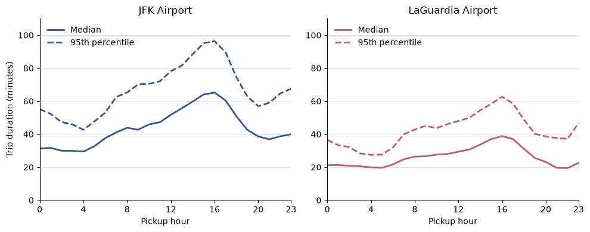
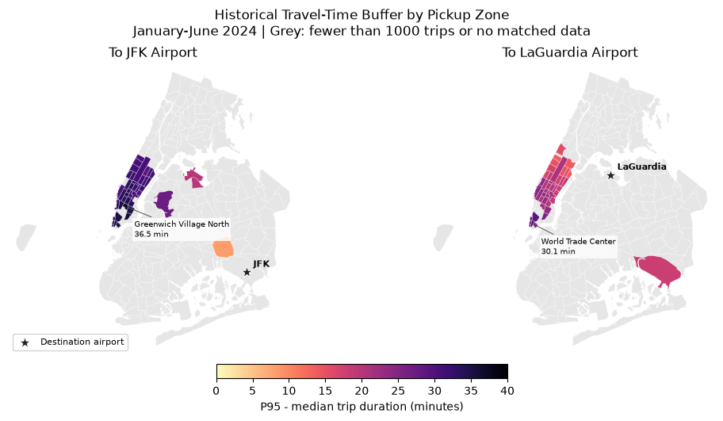
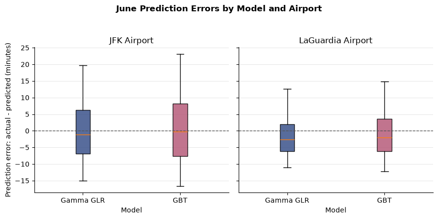

# NYC Airport Taxi Travel-Time Prediction

**How much extra time should passengers allow when taking a yellow taxi to JFK or LaGuardia?**

An end-to-end data science project combining **400,942 airport trips**, hourly weather observations and taxi-zone geography. Built with **Python, PySpark / Spark ML, pandas, GeoPandas and Matplotlib**.



## Key results

| June 2024 holdout | Gamma GLR | Gradient-boosted trees |
| --- | ---: | ---: |
| MAE (minutes) | 7.049 | 8.089 |
| RMSE (minutes) | 9.832 | 11.164 |
| R-squared | 0.732 | 0.654 |
| Historical residual buffer (minutes) | 20.68 | 22.47 |
| Coverage with buffer | 96.99% | 96.54% |

Gamma GLR achieved the lowest June error among the two shortlisted models. Median observed duration was **50.15 minutes to JFK** and **28.35 minutes to LaGuardia**. Removing weather features increased May validation MAE from 8.120 to 8.388 minutes for Gamma GLR and from 9.108 to 9.140 for GBT.

These metrics come from the original saved [result tables](tables/). They have not been independently regenerated for this portfolio edition. Aggregate coverage is not a guarantee for an individual journey.

## Skills demonstrated

- Public-data ingestion, cleaning and hourly weather joins in PySpark.
- Calendar and categorical feature engineering with training-only fitted Spark ML pipelines.
- Temporal, weather and geospatial exploration with sample-size thresholds.
- Comparison of ridge regression, Gamma GLR, random forest and gradient-boosted trees.
- Expanding-window validation, weather-feature ablation and historical prediction-error buffers.

## Workflow

1. Download January-June 2024 NYC yellow-taxi records, taxi zones and airport weather.
2. Select trips ending at JFK (zone 132) or LGA (zone 138), apply plausibility filters, derive pickup-time features and join weather by airport/hour.
3. Explore journey duration by departure time, pickup zone and weather.
4. Train on January-March and screen four models on April. Train through April and validate Gamma GLR and GBT on May, including a weather-removal comparison.
5. Train through May and evaluate on June. Add a nonnegative buffer based on the 95th percentile of pooled April/May out-of-sample residuals (actual minus predicted).

The descriptive buffer in maps/heatmaps is **P95 minus median observed duration**. The model buffer is **P95 of historical prediction errors**; these are different quantities.





## Repository guide

| Location | Contents |
| --- | --- |
| `code/01_download_data.ipynb` | Download public source data |
| `code/02_preprocessing.ipynb` | Clean, engineer features and join weather |
| `code/03_analysis.ipynb` | Descriptive and geospatial analysis |
| `code/04_modelling.ipynb` | Models, validation, ablation and buffers |
| `assets/` | PNG previews from saved notebook figures |
| `plots/` | Original PDF figures |
| `tables/` | Original LaTeX result tables |
| `docs/` | Methodology, limitations and provenance |

## Run locally

Use Python and Java versions compatible with your installed PySpark release. Java must be available on PATH. Dependency ranges are inherited from the coursework, with compatibility corrections described in the provenance notes; this edition has no verified environment lockfile.

```bash
python -m venv .venv
# macOS / Linux
source .venv/bin/activate
# Windows PowerShell: .\.venv\Scripts\Activate.ps1
python -m pip install --upgrade pip
python -m pip install -r requirements.txt
jupyter notebook
```

Start Jupyter from the repository root and run the four notebooks in order. Execution from `code/` is also supported. Data is created locally under `data/` and excluded from Git. Initial execution requires internet access, several gigabytes of disk space and sufficient memory for Spark.

Saved figures allow browsing without Spark. Console logs and execution counts were removed; retained visual outputs are from the original run. See [methodology and limitations](docs/METHODOLOGY.md).

## Data sources

- [NYC TLC trip records and taxi zones](https://www.nyc.gov/site/tlc/about/tlc-trip-record-data.page)
- [NOAA Local Climatological Data](https://www.ncei.noaa.gov/products/land-based-station/local-climatological-data): JFK station `74486094789` and LGA station `72503014732`, year 2024

Exact download URLs are in the first notebook. Source datasets are not redistributed and remain subject to their providers' terms.

## Project background

Originally completed by **xialuote77** as an individual project for **MAST30034 Applied Data Science, University of Melbourne**. This portfolio copy is based on source snapshot [acb8295](https://github.com/MAST30034-AppliedDataScience/project-1-individual-xialuote77/tree/acb8295bbcc3faf6ac155334405edf3b5e10bea5).

This edition improves documentation and presentation while preserving the analysis and reported metrics. It is an offline research workflow. See [provenance and changes](docs/PROVENANCE.md).
